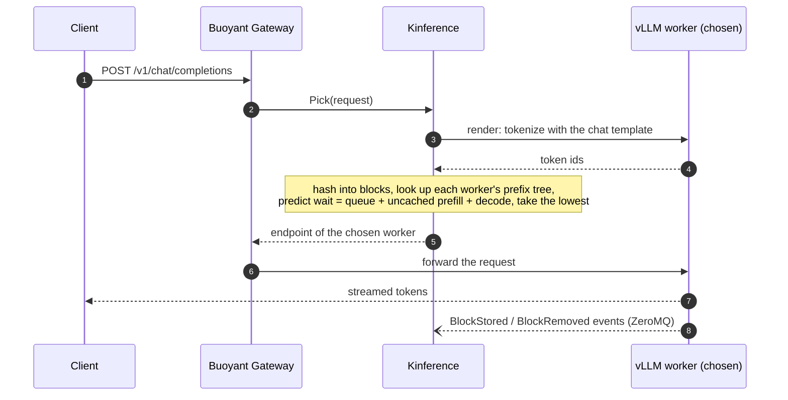
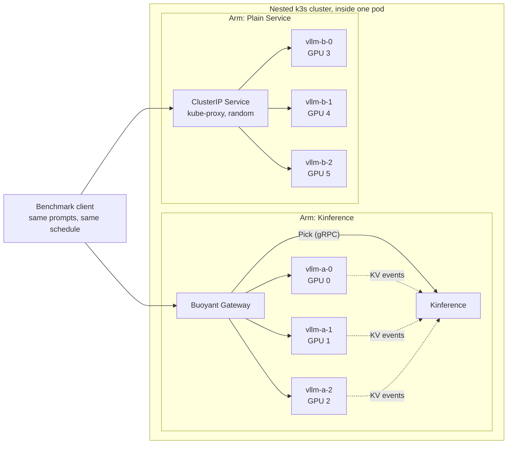
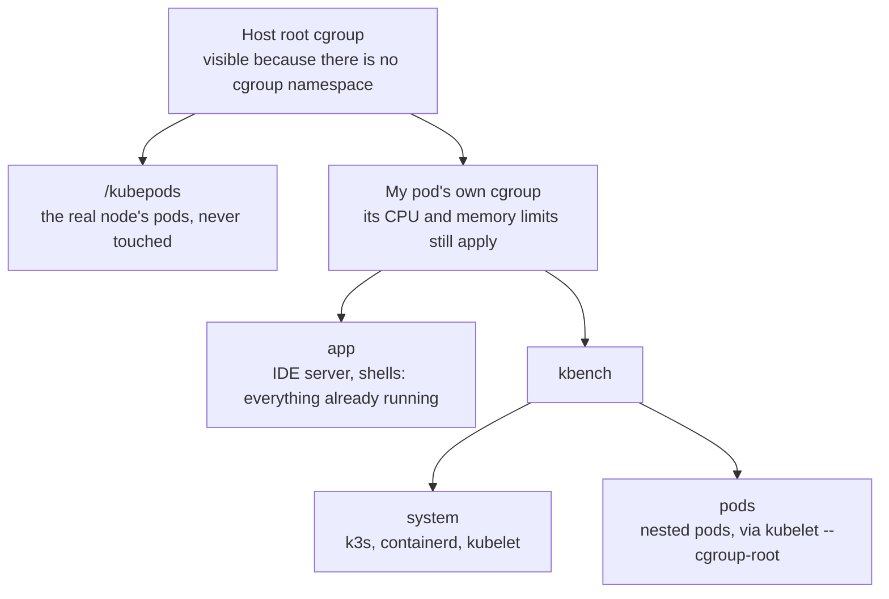

<link rel="stylesheet" href="{{ '/assets/kinference/kb.css' | relative_url }}">

A few weeks ago Buoyant released [[K]inference](https://www.buoyant.io/blog/introducing-kinference), an open source router for vLLM on Kubernetes. They followed it with a [benchmark](https://www.buoyant.io/blog/distributed-inference-benchmarks-kinference-vs-plain-kubernetes) against a plain Kubernetes Service. The headline was a 95% cut in median time-to-first-token on shared-prefix traffic.

Numbers like that make me want to check them myself. I had an 8-GPU machine available, but with a catch: I didn't own the machine. I had one pod on a shared node, with GPUs that other people also use. I couldn't install CRDs on the real cluster. A few GPUs belonged to someone else's long-running job.

So I ran a second Kubernetes cluster inside my pod, put Kinference on it, and ran the benchmark there.

<div class="kb-stats">
  <div class="kb-stat"><b>&minus;93.6%</b><span>median time to first token, shared-prefix traffic (blog: &minus;95%)</span></div>
  <div class="kb-stat"><b>4.1&times;</b><span>peak goodput under an SLO, multiturn chat (blog: 3.5&times;)</span></div>
  <div class="kb-stat"><b>+29&nbsp;ms</b><span>cost of the extra routing hop, against seconds of prefill saved</span></div>
  <div class="kb-stat"><b>144</b><span>benchmark runs, zero request errors, everything uninstalled after</span></div>
</div>

The short version:

- Shared-prefix traffic: median time-to-first-token (TTFT) went from 9.42 s to 0.60 s.
- Multiturn chat: TTFT fell 54%, and peak goodput under an SLO rose 4.1&times;.
- The gain grows with pool size: 1.1&times; with one pod, 3.3&times; with two, 3.6&times; with three.
- In one workload I got 2.9&times; where the blog got 7.4&times;. I traced that to the GPU cache being about 1% too small for the workload. That part ended up being the most useful thing I learned, and there is a calculator for it further down.

Every chart below is drawn from the raw per-request data of those runs. Hover or tap for exact values, use the buttons to switch views, and open "Show the numbers" under a chart for the table.

## Why LLM load balancing is a different problem

An LLM request has two phases. In **prefill**, the model reads the whole prompt in one parallel pass and stores a key and value vector for every token in every layer. That store is the KV cache. In **decode**, it generates output one token at a time, each step reading the cache.

Prefill time grows with prompt length, and it's what you feel as time-to-first-token. On my GPUs, prefilling a 16,000-token prompt with a 27B model takes about 8.2 seconds. RAG, agents and long chats all send long prompts, so for them TTFT is mostly prefill.

vLLM has a feature that makes most of that work avoidable. It stores the KV cache in fixed-size blocks, and each block is identified by a hash of its own tokens plus everything before it. With `--enable-prefix-caching`, a new request whose first blocks match blocks already in memory skips prefill for those tokens. If 1,000 users ask questions about the same 16k-token document, only the first one should pay the 8 seconds. Everyone after that pays for about 256 new tokens, which takes around half a second.

The catch is that each GPU has its own cache. Replica B can't use what's in replica A's memory.

Now look at how a normal Kubernetes Service picks a replica. In iptables mode, kube-proxy makes a random choice for each new connection. This is the actual rule from my cluster for a three-pod pool:

```text
-A KUBE-SVC-... -m statistic --mode random --probability 0.33333 -j KUBE-SEP-...(pod 1)
-A KUBE-SVC-... -m statistic --mode random --probability 0.50000 -j KUBE-SEP-...(pod 2)
-A KUBE-SVC-...                                                  -j KUBE-SEP-...(pod 3)
```

With N replicas, a request has about a 1 in N chance of landing on the pod that already holds its prefix. When it misses, it pays full prefill and also writes a second copy of that prefix into another GPU's cache, pushing out something else that was useful. The pool's effective cache shrinks toward the size of a single GPU's. kube-proxy also knows nothing about queue depth or cache pressure. It only knows whether a pod is Ready.

You can feel this effect in a few seconds with the toy model below. Each GPU holds a fixed number of prefixes and evicts the least recently used one. Drag "GPUs in the pool" up and watch random routing fall while cache-aware routing holds. Then push "Distinct shared prefixes" past what the pool can hold.

<figure class="kb-fig" data-kb="sim">
  <p class="kb-title">Toy model: random vs cache-aware routing</p>
  <p class="kb-sub">6,000 simulated requests, each needing one shared prefix. Simulated, not measured.</p>
  <div class="kb-chart"><p class="kb-fallback">This interactive simulator needs JavaScript. In short: with 3 GPUs that each hold 8 prefixes and 24 prefixes in use, random routing finds the prefix about a third of the time and cache-aware routing almost always.</p></div>
</figure>

> The simulator is a deliberately small model: one prefix per request, LRU eviction, no queues or timing. It shows the shape of the problem, not real latencies. "Spill under load" is the share of requests the router sends away from the warm GPU, which is roughly what Kinference does when that GPU is busy.
{: .prompt-info }

## What Kinference does instead

Kinference is a routing service that a gateway asks, once per request, "where should this go?" For each worker it estimates how long this request would wait for its first token there, and it picks the lowest estimate.

The estimate is roughly:

```text
predicted_wait = base
               + remaining prefill already queued on this worker
               + prefill cost of the tokens this worker does NOT have cached
               + a small decode-contention term
```

The term that does the work is the uncached tokens. A worker that holds the 16k prefix has about 256 uncached tokens; a cold one has 16,000. The queue term stops one warm worker from taking everything. If it's busy enough, sending the request to a cold, idle worker comes out cheaper.

To know what's cached where, Kinference uses three sources of information:

1. **KV events from vLLM.** Each vLLM worker publishes `BlockStored` and `BlockRemoved` events over ZeroMQ. Kinference keeps a prefix tree of block hashes for each worker. Events carry sequence numbers, and when Kinference sees a gap it asks the worker's replay socket for the missing events. That keeps the index from drifting silently out of sync with the real cache.
2. **Its own routing decisions.** When Kinference sends a request somewhere, it immediately records that prefix as on its way to that worker. Without this, a burst of ten requests with a brand-new prefix would scatter across workers, because none of them would show up as warm until vLLM's events arrived.
3. **Load metrics.** It reads running and waiting request counts and cache usage from each worker's `/metrics` endpoint every second.

To hash blocks the same way vLLM does, Kinference has to tokenize the prompt exactly as the engine will, chat template included. By default it calls vLLM's `/v1/chat/completions/render` endpoint to do this, so the tokens match exactly.

Kinference doesn't proxy any traffic. The [Buoyant Gateway](https://www.buoyant.io/), an implementation of the Kubernetes Gateway API, does the proxying. A route on the gateway points at an `InferencePool`, and an extension on that route calls Kinference's gRPC `Pick` API for each request:



I set that extension to `failureMode: Closed`, so if Kinference is down, requests fail instead of quietly falling back to random routing. For production you might choose the opposite. For a benchmark, a silent fallback would have made the results meaningless.

Here's the full test setup. The two pools are identical: same container image, same vLLM flags, same model files, one GPU per worker. The only difference is how requests get routed.



GPU 6 belonged to someone else's job and was never touched. GPU 7 ran smoke tests.

## The environment, and why it was the hard part

The benchmark harness took a few days. Getting a cluster to run safely inside a pod on a shared machine took longer. Here's what I was working with:

- One privileged pod on a shared Kubernetes node. My service account could only touch one namespace, so installing CRDs was out.
- cgroup v2 mounted read-write with **no cgroup namespace**. From inside the pod, `/sys/fs/cgroup` was the host's root cgroup.
- A kernel shared with everyone else on the node.
- An Istio sidecar intercepting all TCP traffic from the pod.
- Outbound traffic through a corporate proxy that decrypts and re-signs TLS for some domains.
- A root filesystem on overlayfs, on a disk shared with other users.
- 8&times; RTX 6000 Ada (48 GB, the same AD102 chip as the L40S in Buoyant's test), capped at 300 W. One GPU was busy with another user's training job.

Each of these needed its own workaround.

### A cluster inside a pod

Kinference and the gateway need CRDs at cluster scope, EndpointSlice watches, Leases, and permission to create Deployments. I had none of that on the real cluster, so I brought my own. I picked **k3s** because it's a single binary with the API server, kubelet, containerd, flannel, kube-proxy and CoreDNS built in. kind needs Docker, which the pod didn't have, and kubeadm needs systemd and much more host setup.

I turned off the parts I didn't need (Traefik, servicelb, metrics-server) and gave the nested cluster pod and service ranges of `10.88.0.0/16` and `10.89.0.0/16`. k3s defaults to 10.42/10.43, which were exactly the outer cluster's ranges. Overlapping routes would have sent traffic into a black hole at both levels.

### Keeping the nested kubelet out of the host's cgroups

This was the part I was most careful with. kubelet builds its pod hierarchy under `/kubepods` by default. Without a cgroup namespace, that's the **host's** `/kubepods`, the same tree that holds every other pod on the node. A misconfigured nested kubelet could reparent or kill workloads that belong to other people.

cgroup v2 has a "no internal processes" rule: a cgroup that hands controllers down to child cgroups can't also contain processes itself. So I first moved every process already in my container (the IDE server, shells) into a child cgroup. Then I created the cluster's hierarchy next to it:



The whole nested cluster sits inside my pod's existing CPU and memory limits and can't see anyone else's cgroups. Tearing it down is one write to `cgroup.kill` followed by `rmdir`.

### Leaving the shared kernel alone

By default kube-proxy writes `nf_conntrack_max` and conntrack timeouts. On a shared kernel those settings are node-wide, and changing them would change networking for every pod on the host. Setting `conntrack-max-per-core=0` and both timeouts to `0s` tells kube-proxy to leave them alone. I also ran kubelet with `protect-kernel-defaults=true`, so it fails on a kernel setting it dislikes instead of changing it. I used flannel's `host-gw` backend because it only installs routes and doesn't need the vxlan kernel module, which I couldn't load.

### Getting Istio out of the way

This could have quietly broken the experiment. Istio's sidecar sets up iptables rules that send all outbound TCP to Envoy. Envoy keeps connection pools and does its own load balancing. If nested-cluster traffic went through it, the "plain Kubernetes" arm would no longer be kube-proxy's random choice. It would be Envoy's, with extra latency on only some paths.

I added three `RETURN` rules at the top of Istio's chains, one for the nested CNI bridge and one for each nested address range. Everything else from the pod, like Jupyter and NFS, still goes through Istio as before.

### The TLS-intercepting proxy

Some image and chart pulls failed with `x509: certificate signed by unknown authority`, and others worked. The proxy re-signs some domains and passes others through untouched. I pulled the certificate chain from an intercepted handshake with `openssl s_client -proxy ... -showcerts`, checked the fingerprints, and added it to the system trust store, which containerd uses.

A second surprise: the system `curl` and several Python HTTP libraries ignore IP ranges in `no_proxy`. So benchmark traffic to the nested pod IPs was quietly going out through the corporate proxy. The benchmark client now uses `aiohttp` with `trust_env=False`, and every `curl` call uses `--noproxy '*'`.

### An image store that didn't fill the shared disk

containerd's overlayfs snapshotter can't build on top of a root filesystem that is itself overlayfs. The fallback "native" snapshotter makes a full copy of every image layer. With the vLLM image, disk usage climbed past 150 GB before I stopped it, on a disk other people depend on.

The fix was a 160 GB **sparse** file, formatted as ext4 and loop-mounted at containerd's data directory, with the overlayfs snapshotter switched back on. Because the file is sparse, it only takes up the space actually written, which came to about 31 GB. Loop devices are shared across the whole host, so uninstall detaches it explicitly.

### GPUs without the device plugin

The NVIDIA Container Toolkit makes GPUs available inside the nested pods: k3s detects it and registers a `nvidia` RuntimeClass. I skipped the NVIDIA device plugin and pinned each vLLM Deployment to one GPU by UUID with `NVIDIA_VISIBLE_DEVICES`. Placement is predictable: worker `a-0` is always GPU 0, and nothing can ever land on the GPU that belongs to someone else. The downside is that the scheduler doesn't track GPUs, so getting placement right is my job. For a hand-pinned single-node benchmark that's fine.

Before every set of runs, a pre-flight check confirms GPUs 0 to 5 are idle. If someone else started a job on one of them, I'd know before it affected a run.

### vLLM flags I only found by debugging

I used the same model as the blog, `Qwen/Qwen3.8-27B-FP8`, on vLLM 0.31.0. The weights are about 28 GB, which leaves room for KV cache on a 48 GB card. I copied them from network storage to local disk once, so six pods weren't each reading 28 GB over NFS.

Two flags weren't obvious:

- `--enable-scale-out`. Kinference's tokenize call to `/v1/chat/completions/render` kept returning 404. After reading vLLM's router code, I found the render endpoints are only registered when this flag is set. I set it on both pools to keep their flags identical.
- `--enable-prompt-tokens-details`. Without it, `cached_tokens` in the response's usage block is `null`. I wanted that number as an independent check on cache hits that doesn't rely on Kinference's own metrics.

## How I measured

I rebuilt the blog's workloads as closely as I could:

| Workload | Shape |
|---|---|
| control | a unique 16,256-token prompt, 256 output tokens. No reuse is possible. |
| shared-prefix | one of 24 shared 16,000-token prefixes, plus 256 unique tokens |
| multiturn | 8-turn chats: an 8,000-token opener, 400 new tokens per turn, history carried |
| agentic-mix (my addition) | 64 prefixes of 8,000 tokens, picked with a Zipf(1.1) skew, plus a 512-token question |

I needed prompts of an exact token length without depending on a dataset. So I scanned the model's vocabulary for words that encode to exactly one token. A string of N of those words is exactly N tokens. Output length is fixed: generation ignores end-of-sequence and has a minimum length equal to the maximum. So both arms do the same decode work for every request.

There are two kinds of benchmark. The **latency** benchmark is open-loop: requests arrive as a Poisson process at a fixed rate, whether or not the server is keeping up. That's how real users behave, and it avoids coordinated omission, the bias you get when a slow server also slows down how fast requests arrive. The **capacity** benchmark is closed-loop: N clients each send their next request as soon as the last one finishes, for N from 4 to 32. That shows where each arm stops meeting its SLO.

Some details that matter more than they seem:

- **Identical inputs.** Each run's prompts and arrival times come from a seed, so both arms get byte-identical prompts on the same schedule.
- **Cold caches.** I reset the prefix cache on all six workers before every run.
- **A new TCP connection per request**, so kube-proxy makes a fresh random choice each time. Keep-alive would tie a client to one pod, which is unrealistic in a different way.
- **Arms run back to back**, with the order alternating. The blog ran both arms at once. Here both would have shared one 19-core CPU budget and one client process, so each arm's load would have skewed the other's numbers.
- **Calibrated SLOs.** The blog set its SLOs at idle TTFT plus about 20%. My GPUs run at 300 W instead of 350 W and prefill about 22% slower, so copying the blog's 8 s would have been unfair. I measured idle, uncached TTFT on my pools and applied the same rule: **10 s** for 16k prompts and **5 s** for 8k prompts.
- **Statistics.** I used a paired, hierarchical bootstrap. It resamples trials while keeping both arms of a trial together, then resamples requests inside each trial. Requests within one run are correlated, so treating 150 requests as 150 independent samples would make the confidence intervals look tighter than they are. I only call an effect when its 95% interval excludes "no effect".

## Results

### Latency

The chart below is the whole distribution, not just the median. A line further left means faster first tokens; the vertical rule is the SLO. Switch workloads to compare.

<figure class="kb-fig" data-kb="cdf">
  <p class="kb-title">Time to first token, every measured request</p>
  <p class="kb-sub">Cumulative share of requests that got their first token within a given time. Open-loop, 3 trials per arm.</p>
  <div class="kb-controls"></div>
  <div class="kb-chart" tabindex="0" role="img" aria-label="Cumulative distribution of time to first token for Kinference and the plain Service. Use the left and right arrow keys to read values."><p class="kb-fallback">Interactive chart; it needs JavaScript. The table below has the same results.</p></div>
</figure>

<details class="kb-data" markdown="1">
<summary>Show the numbers</summary>

| Workload | Metric | Plain Service | Kinference | Change | Blog |
|---|---|---|---|---|---|
| shared-prefix | median TTFT | 9.42 s | 0.60 s | **&minus;93.6%** | &minus;95% |
| shared-prefix | median end-to-end | 31.4 s | 17.9 s | &minus;43% | &minus;45% |
| multiturn | median TTFT | 1.53 s | 0.70 s | **&minus;54%** | about &minus;65% |
| multiturn | median end-to-end | 12.5 s | 8.7 s | &minus;30% | about &minus;32% |
| agentic-mix | median TTFT | 4.36 s | 0.54 s | &minus;87.6% | not tested |
| control | median TTFT | 9.35 s | 8.53 s | &minus;8.7% | about 0 |
| control | p95 TTFT | 19.7 s | 10.0 s | &minus;49% | 21.5 &rarr; 12.3 s |

</details>

The shared-prefix lines tell the story. With Kinference, most requests start in about half a second. With random routing the curve is a cliff around 8 to 10 seconds: that's the cost of prefilling 16k tokens from scratch, paid by most requests.

To see it request by request, here is one 4-minute trial. A filled dot found its prefix already cached; a hollow dot had to prefill it.

<figure class="kb-fig" data-kb="scatter">
  <p class="kb-title">One shared-prefix trial, request by request</p>
  <p class="kb-sub">51 requests per arm, byte-identical prompts on the same schedule.</p>
  <div class="kb-controls"></div>
  <div class="kb-chart" tabindex="0" role="img" aria-label="Scatter plot of time to first token against arrival time for one trial. Use the left and right arrow keys to step through requests."><p class="kb-fallback">Interactive chart; it needs JavaScript. In this trial most Kinference requests were cache hits near 0.5 s, and most plain Service requests were misses near 8 to 10 s.</p></div>
</figure>

vLLM's own counters agree. On shared-prefix, each pod's hit rate was 52 to 60% with Kinference and 11 to 22% with random routing.

The control row doesn't quite match the blog, which found no difference in median TTFT. I come back to that in the GPU section below, because it turned into its own investigation.

### Capacity

Goodput is the number of requests per minute whose first token arrived within the SLO target. A concurrency level "meets the SLO" when at least 90% of its requests do; switch the chart to "SLO attainment" to see where each arm crosses that line.

<figure class="kb-fig" data-kb="capacity">
  <p class="kb-title">Capacity under closed-loop load</p>
  <p class="kb-sub">N clients, each sending its next request as soon as the last one finishes.</p>
  <div class="kb-controls"></div>
  <div class="kb-chart" tabindex="0" role="img" aria-label="Goodput, SLO attainment or cache hit rate against concurrency for both arms. Use the left and right arrow keys to read values."><p class="kb-fallback">Interactive chart; it needs JavaScript. The table below has the peak values.</p></div>
</figure>

<details class="kb-data" markdown="1">
<summary>Show the numbers</summary>

| Workload | Peak goodput, Service &rarr; Kinference | Highest concurrency meeting SLO (Service / Kinference) | Blog |
|---|---|---|---|
| multiturn | 15.5 &rarr; 64.4 req/min (**4.1&times;**) | none / 16 | 3.5&times;; none / 8 |
| shared-prefix | 7.1 &rarr; 20.9 req/min (**2.9&times;**) | none / 8 | 7.4&times;; none / 32 |
| agentic-mix | 1.6&times; at 8, 2.2&times; at 16, 3.3&times; at 32 clients | | not tested |

</details>

On multiturn I did better than the blog. A conversation grows by about 600 tokens per turn, and old conversations finish, so the set of live histories fits comfortably in cache. Kinference kept each conversation on its own pod, with a hit rate around 80% up to 16 concurrent users. With random routing it fell from 55% to somewhere between 11% and 32%. Switch the chart to "Cache hit rate" to see it.

On shared-prefix I fell well short of the blog. That's the next section.

### Two extensions

The **agentic-mix** workload is closer to how I see LLMs used day to day: a few very popular system prompts and a long tail of rare ones. Median TTFT dropped from 4.36 s to 0.54 s (&minus;87.6%). Unlike shared-prefix, the advantage grew with load: 1.6&times; goodput at 8 concurrent users, 2.2&times; at 16, 3.3&times; at 32. The popular prefixes fit in cache, so routing to the warm pod keeps paying off.

The **pool-size sweep** is my favorite result, because it has its own control built in:

<figure class="kb-fig" data-kb="sweep">
  <p class="kb-title">The advantage grows with the pool</p>
  <p class="kb-sub">Same workload, 1, 2 and 3 GPUs per pool, 8 concurrent clients.</p>
  <div class="kb-controls"></div>
  <div class="kb-chart" tabindex="0" role="img" aria-label="Grouped bars of goodput or cache hit rate for 1, 2 and 3 pods per pool. Use the left and right arrow keys to read values."><p class="kb-fallback">Interactive chart; it needs JavaScript. The table below has the same results.</p></div>
</figure>

<details class="kb-data" markdown="1">
<summary>Show the numbers</summary>

| Pods per pool | multiturn goodput ratio | shared-prefix goodput ratio |
|---|---|---|
| 1 | 1.10&times; (not significant) | 0.97&times; (not significant) |
| 2 | 3.25&times; | 1.97&times; |
| 3 | 3.61&times; | 2.93&times; |

</details>

With one pod there's nothing to choose between, so the two arms should be identical, and they are. As the pool grows, random routing's chance of finding the warm pod falls like 1/N while Kinference keeps finding it, so the gap widens. The per-pod hit rates show the same thing directly: Kinference's multiturn hit rate went from 0.46 to 0.81 to 0.82, while random routing stayed around 0.44. It's the same curve the toy model at the top draws.

The routing itself is cheap. With one pod, so no choice to make, fully warm requests took 0.644 s through Gateway and Kinference against 0.615 s direct. That's about 29 ms on top of a request, compared with 8 to 12 seconds of prefill saved on every cache hit.

## Where it didn't match the blog, and why

On shared-prefix capacity I got 2.9&times; where the blog got 7.4&times;, and Kinference held the SLO only up to 8 concurrent users instead of 32. I wanted to explain that gap, not just report it.

I counted how many requests in each run had more than 8,000 cached tokens, using vLLM's own `cached_tokens` field. With Kinference, the hit rate was high at 4 and 8 concurrent users and then fell sharply. At 24 it was about as bad as random routing.

<figure class="kb-fig" data-kb="sphits">
  <p class="kb-title">Shared-prefix: requests that found their prefix cached</p>
  <p class="kb-sub">Share of requests with more than 8,000 cached prompt tokens, as reported by vLLM.</p>
  <div class="kb-controls"></div>
  <div class="kb-chart" tabindex="0" role="img" aria-label="Line chart of prefix hit share against concurrency. Use the left and right arrow keys to read values."><p class="kb-fallback">Interactive chart; it needs JavaScript. Kinference: 61%, 58%, 32%, 13%, 8% at 4, 8, 16, 24, 32 clients. Plain Service: 17%, 15%, 15%, 10%, 11%.</p></div>
</figure>

The explanation is arithmetic:

- vLLM reported **126,976 tokens** of KV cache per pod (FP8 weights, `gpu-memory-utilization=0.90`, 48 GB card), so about **381k** for a pool of three.
- The workload has **24 prefixes &times; 16k tokens = 384k**.

The working set is about 101% of the pool's entire cache, before counting the unique tokens of the requests running at that moment. Try it yourself:

<figure class="kb-fig" data-kb="kv">
  <p class="kb-title">Does the working set fit?</p>
  <p class="kb-sub">KV cache in the pool against the tokens the shared prefixes need.</p>
  <div class="kb-chart"><p class="kb-fallback">This calculator needs JavaScript. With my settings the pool holds about 381k tokens of KV cache and the prefixes need 384k: 101%.</p></div>
</figure>

> The calculator starts from vLLM's reported numbers for my setup (126,976 tokens, 8.9 GiB of KV cache per pod at 0.90) and scales linearly. The other presets are estimates of what each change would give, not measurements. FP8 stores each cached value in half the bytes of BF16.
{: .prompt-info }

At low load, Kinference can split the prefixes about eight per pod, and nearly everything fits. Under load, its queue term sometimes sends a hot prefix to a less busy pod, which is exactly what it's designed to do. That pod prefills the prefix again and stores a duplicate copy, and the pool has to evict a prefix it will need soon. Repeat that and you get thrashing; vLLM starts preempting requests at 16 concurrent users. Set the toy model at the top to 24 prefixes, 8 per GPU, and some spill, and you can watch the same thing happen. I want to be careful here: this mechanism fits all the evidence, but I didn't log which pod served each request, so I haven't confirmed it request by request.

The agentic-mix results support this explanation. Its popular head fits in cache, and there the advantage keeps growing under load. The limit is how much the cache can hold, not the routing.

The lesson I took away: when you plan capacity for cache-aware routing, compare the number of distinct prefix tokens against the pool's KV capacity (`num_gpu_blocks × block_size`), not just requests per second. If the working set doesn't fit, a smarter router can't save you. There are three ways to fix it:

1. Store the KV cache in FP8 (`--kv-cache-dtype fp8`), which roughly doubles capacity per GPU. Ada supports FP8 natively.
2. Give vLLM more memory, or add more replicas.
3. Make the router less willing to leave a warm pod, by tuning the queue weight or the replication threshold.

I also saw a crossover at 32 concurrent users. Both arms were overloaded, and Kinference's SLO attainment dropped to zero while random routing kept 6 to 21%. Throughput was the same; what changed was the spread. Kinference spreads the overload evenly, so every request waits about the same and every one misses the target. Random routing is lopsided, so some pods are lightly loaded and some requests get lucky. A goodput metric rewards that luck near the SLO limit. The practical fix is admission control or autoscaling that keeps you below that point, not a better router.

Buoyant's post doesn't say what KV cache size, memory fraction or KV data type they used, so I can't tell exactly why their setup didn't hit this limit. A slightly larger memory fraction or an FP8 cache would be enough.

## The GPU that looked slower

On the control workload, where no prompt can be reused, Kinference came out about 9% faster. The blog found no difference, and I was suspicious too, since there's nothing for a cache-aware router to exploit on that workload.

GPU telemetry showed something odd. All six GPUs are the same model with the same 300 W cap, and all were drawing about 299 W under load. But at that cap, pool B's GPUs ran at about 1.1 to 1.3 GHz in almost every control run, while pool A's often held 2 GHz or more. The only limit in effect was the software power cap, and pool B's GPUs were hotter: 56 to 70 &deg;C against about 30 &deg;C. At a fixed power budget, a hotter chip leaks more current, so it can sustain fewer MHz.

That could mean pool B's GPUs were simply slower chips, which would have biased every result in Kinference's favor. To check, I wrote a small probe that sends identical, uncached 16k-token prefills straight to each pod, bypassing both routing paths. I ran it after the main runs, when all six GPUs had warmed to about the same temperature.

<figure class="kb-fig" data-kb="gpu">
  <p class="kb-title">Same GPU model, different clocks, same speed once warm</p>
  <p class="kb-sub">Left: median SM clock of each GPU while at its 300 W cap during the control runs. Right: a direct uncached 16k prefill on each GPU, measured afterwards with all GPUs warm.</p>
  <div class="kb-controls"></div>
  <div class="kb-split">
    <div><h4>Clock at full power</h4><div class="kb-chart" data-part="clock" tabindex="0" role="img" aria-label="Dot chart of each GPU's clock at the power cap, one dot per control trial. Use the left and right arrow keys to read values."><p class="kb-fallback">Pool A (GPUs 0 to 2): 1.2 to 2.7 GHz. Pool B (GPUs 3 to 5): 1.1 to 1.3 GHz in 8 of 9 trials.</p></div></div>
    <div><h4>Direct prefill probe</h4><div class="kb-chart" data-part="probe" tabindex="0" role="img" aria-label="Bar chart of median prefill time per GPU. Use the left and right arrow keys to read values."><p class="kb-fallback">GPUs 0 to 5: 8.57, 8.25, 7.97, 8.50, 8.35, 8.29 s.</p></div></div>
  </div>
</figure>

Pool A's median was 8.25 s and pool B's was 8.35 s, a 1.2% difference. The clock gap had been thermal and temporary, not a property of the chips.

What remained of the control-row difference fits load balancing. Kinference spread control requests 35/36/39 across its pods; random routing gave 48/30/32.

<figure class="kb-fig" data-kb="pods">
  <p class="kb-title">Control workload: requests served by each GPU</p>
  <p class="kb-sub">All three trials. An even split means fewer long prefills colliding on one GPU.</p>
  <div class="kb-chart" tabindex="0" role="img" aria-label="Stacked bars of requests per GPU for each arm. Use the left and right arrow keys to read values."><p class="kb-fallback">Kinference: 35, 36, 39 requests on GPUs 0, 1, 2. Plain Service: 48, 30, 32 on GPUs 3, 4, 5.</p></div>
</figure>

When two long prefills land on the same GPU, both slow down, and decode speed shows it: 71 ms per token on the random arm against 41 ms with Kinference. I can't separate the thermal part from the load-balancing part exactly, so I report that row with a caveat. The &minus;94% and &minus;54% headline results are far larger than either effect.

Lesson: "identical hardware" is something you measure, and you measure it in the same thermal state as the experiment.

## Tearing it all down

This setup existed only for the benchmark, on a machine other people use. I treated cleaning up afterwards as a requirement from day one, not as a chore for the end.

Before changing anything, I saved a snapshot of the pod's network links, routes, mounts, cgroup path, iptables rules and `ip_forward`. Every change I made went into a ledger along with how to undo it:

| What I changed | How it was undone |
|---|---|
| Packages, binaries (k3s, helm, just), trusted CA files | removed, trust store rebuilt |
| cgroup subtree for the nested cluster | `cgroup.kill`, `rmdir`, processes moved back |
| Istio `RETURN` exceptions, cluster iptables chains | deleted, rules diffed against the snapshot |
| CNI links, routes, `ip_forward` | removed and restored |
| Loop-mounted image store, model copy on local disk | unmounted, loop device detached, files deleted |

The uninstall script kills the nested cgroup tree, unmounts from the deepest mount up, removes the cluster's network links and iptables chains along with my Istio exceptions, restores the cgroup layout, and removes everything else. A verification script then runs 12 checks against the snapshot.

The first uninstall run still taught me something. After `cgroup.kill`, a cgroup can report no processes and still refuse `rmdir` with EBUSY for a moment while the kernel finishes cleaning up the killed tasks. That one failed `rmdir` blocked everything after it, because you can't turn off a parent's controllers while it has children. I fixed it by hand, added a retry loop to the script, and ran the uninstall again to confirm it did nothing the second time. All 12 checks pass, and the pod matches its starting snapshot.

## What I'd tell someone trying this

- On a machine you don't own, decide how you'll undo everything before you install anything. The snapshot and ledger cost an hour and saved me from guessing at the end.
- Without a cgroup namespace, a nested kubelet can reach the host's pod tree. Confine it first, before anything else.
- Check that your baseline really is the baseline. One Istio rule would have turned "plain kube-proxy" into "Envoy load balancing" without any visible sign.
- Measure your hardware instead of assuming the GPUs are identical, and do it in the same thermal state you'll benchmark in.
- Work out the cache working set before choosing workload sizes. KV-aware routing can only exploit reuse the cache can actually hold.
- Report the result that disagrees with the original. The shared-prefix gap taught me more than the matching numbers did.

Thanks to the Buoyant team for publishing their method in enough detail to reproduce, and for releasing Kinference as open source. I'm not affiliated with Buoyant; this was an independent reproduction.

**Setup at a glance:** k3s v1.36.6, Buoyant Gateway 0.1.0-alpha.7, Kinference 0.1.0-alpha.8, Gateway API v1.5.1, vLLM 0.31.0, `Qwen/Qwen3.8-27B-FP8`, 2 pools &times; 3 workers on RTX 6000 Ada (48 GB, 300 W), Prometheus and Grafana for monitoring, and a custom asyncio benchmark client with a paired bootstrap for analysis.

<script src="{{ '/assets/kinference/data.js' | relative_url }}" defer></script>
<script src="{{ '/assets/kinference/kb.js' | relative_url }}" defer></script>
